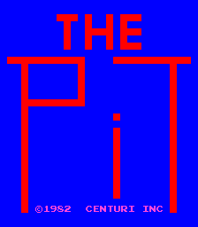
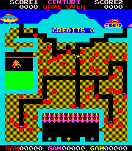

# The Pit for MiSTer

## Overview

FPGA implementation of **The Pit**, originally released by Centuri in 1982.

Current status: functional behavioural implementation, mainly based on MAME/reference behaviour and available arcade hardware documentation.

The core implements the original game's video, audio, controls and high-score persistence.

## How this core was developed

This core was developed with the help of AI coding tools, which I used to write the code where my own experience fell short. Its current behaviour is largely based on MAME.

I have compiled a netlist from the original The Pit manuals, and I am now refactoring the core against it one circuit at a time, so that it moves closer to the original hardware.

## Screenshots

| | |
| --- | --- |
|  |  |

## Installation

1. Copy `releases/Arcade-ThePit_20260929.rbf` to `/_Arcade/cores/` as `ThePit_20260929.rbf`. The official Distribution installer removes the `Arcade-` prefix.
2. Copy `releases/The Pit (US set 1).mra` to `/_Arcade/`.
3. Supply your legally obtained `thepitu1.zip` in `/games/mame/` and launch the MRA.

**Important:** Move older The Pit RBFs outside `/_Arcade/cores/` before installing this release to avoid loading the wrong version.

No ROMs are included. The MRA uses the `thepitu1` ROM set.

For additional information, see the [MiSTer Arcade ROM guide](https://github.com/MiSTer-devel/Main_MiSTer/wiki/Arcade-Roms).

## Controls and settings

The core supports Fire, Coin, Start 1P and Start 2P.

Controller mappings can be customized through MiSTer.

OSD options include:

- Coinage
- Game Speed
- Time Limit
- Flip Screen
- Cabinet
- Lives
- Diagnostic Tests
- Orientation (Native / Rotate CW)

Screen orientation is independent of the game's cabinet and flip settings.

## High-score persistence

The core supports high-score saving through MiSTer's NVRAM system.

The NVRAM file is stored at:

`/media/fat/config/nvram/The Pit (US set 1).nvm`

High-score saving and restoration have been successfully tested on hardware within the accepted test scope.

**Important:** The NVRAM filename depends on the MRA filename. Back up your existing `.nvm` file before renaming or replacing the MRA.

The save mechanism is serviced through the MiSTer menu. A displayed saving indication does not necessarily confirm that the data has been written permanently to storage.

The release MRA differs from the hardware-tested MRA only in its RBF reference. This publication variant has been checked but has not been separately tested on hardware.

## Credits and licences

**GPL-3.0-or-later covers harlock74's original contributions only.**

Inherited material retains its own terms and notices.

| Component | Credits | Applicable terms / reference |
|---|---|---|
| The Pit game/video/audio implementation and high-score support | harlock74; inherited The Pit contributors where applicable | Scoped [owner grant](LICENSE); inherited terms retained |
| MiSTer integration and framework | MiSTer Template contributors, including Till Harbaum and Alexey Melnikov | Retained GPL/LGPL and component-specific notices |
| T80 Z80 CPU | Daniel Wallner, Sorgelig and credited contributors | Original source/synthesized-form conditions retained |
| JT49 sound implementation | Jose Tejada Gomez and contributors | GPL-3.0-or-later; original notices retained |
| PLL and reconfiguration IP | Intel / Altera | Original vendor notices and device-use restrictions |
| Build and test infrastructure | MiSTer Template and project contributors | Original component notices retained |

For complete third-party attribution, licensing details and source provenance, see [NOTICE.md](NOTICE.md), [LICENSE](LICENSE), retained source headers and the accompanying `LICENSES/` directory.

Game ROMs and other copyrighted game assets are not distributed.

## Building the core

The project targets the Cyclone V **5CSEBA6U23I7** FPGA and uses **Quartus Prime Lite 17.0.2 Build 602**.

Open `ThePit.qpf` in Quartus and select **Full Compilation**.

Alternatively, from the project directory, run:

`quartus_sh --flow compile ThePit -c ThePit`

Required source files, IP, constraints and generator scripts are included in the repository.

The supplied release RBF is the previously tested build. A newly compiled RBF should be tested independently before distribution.

**Release SHA-256:**

`Arcade-ThePit_20260929.rbf`

`85a95a4ba5813f8bdd95b7de392d59aa6b835ad1ecf72f2aa97a85537879f107`

**MRA SHA-256:**

`The Pit (US set 1).mra`

`de696947ec479dc4e9da1a48160fddb28a7e5100713c3f2028bd0751887b1cbc`